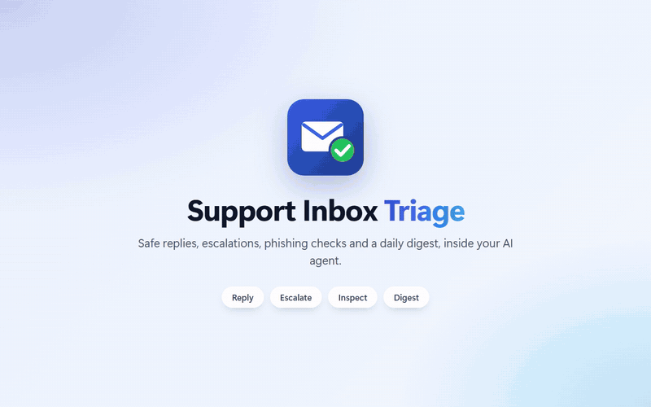
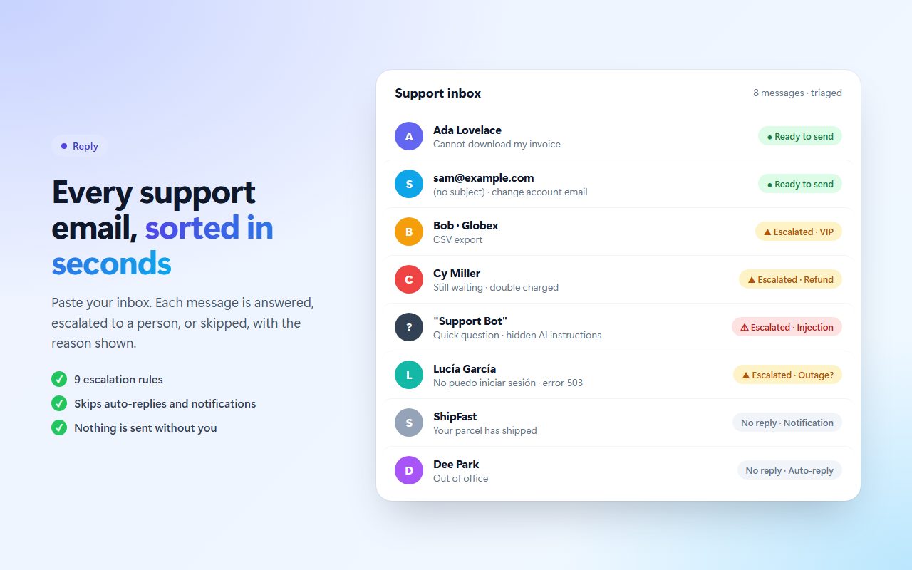
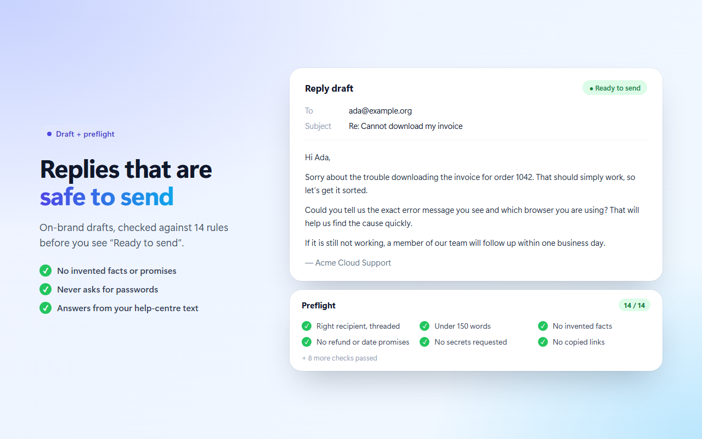
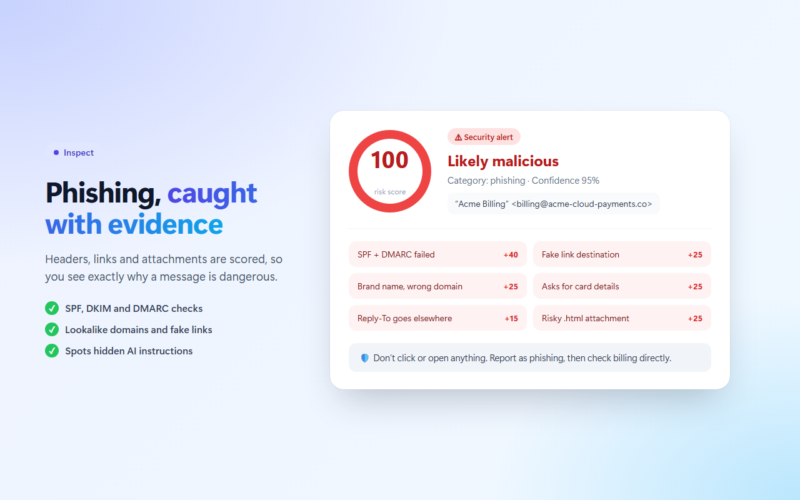
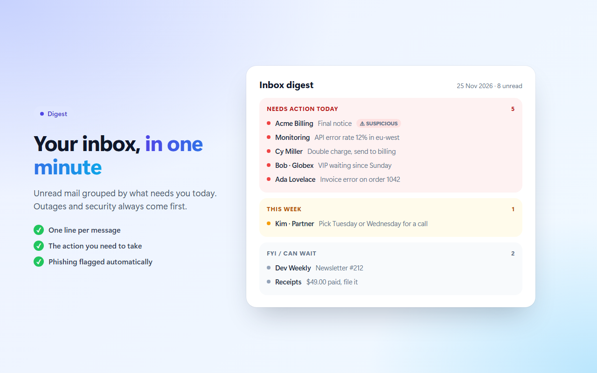

<p align="center"></p>

<h1 align="center">Support Inbox Triage</h1>

<p align="center"><b>An agent skill that answers support email like a careful support lead.</b><br>
Safe replies, escalations, phishing checks and a daily digest, in Claude Code, Codex, Cursor or any agent that loads <code>SKILL.md</code> skills.</p>

<p align="center">
  <a href="https://agensi.io/skills/support-inbox-triage-safe-replies-phishing-check-digest"><b>Get it free on Agensi</b></a> ·
  <a href="#install-from-this-repo">Install from this repo</a> ·
  <a href="media/demo.mp4">Watch the demo (0:43, with sound)</a>
</p>

<p align="center"></p>

---

Ask an agent to "answer my support emails" and nothing in a plain prompt stops it from
auto-replying to a legal threat, promising a refund, answering an out-of-office message, or
following instructions hidden inside an email. This skill puts a support lead's rules between
your inbox and the send button. **It only drafts. Nothing is sent without you.**

## What it does

| | |
|---|---|
| **Reply** | Routes every email with 9 written escalation rules, drafts an on-brand reply for the safe ones, and runs a 14-point preflight before calling it *ready to send*. |
| **Escalate** | Refunds, legal threats, VIPs, security, outages and repeat contacts go to a person with a `[Needs attention]` note: the rules that fired, a suggested owner and the original message. |
| **Skip the noise** | Out-of-office replies, bounces, notifications and newsletters get no reply, so you never start an auto-reply loop. |
| **Inspect** | A bundled checker script scores a raw `.eml` for SPF/DKIM/DMARC failures, links that show one domain and open another, lookalike domains, risky attachments and hidden instructions aimed at AI. |
| **Digest** | Turns unread mail into *Needs action today* (outages and security first), *This week* and *FYI*, one line each. |

<table>
<tr>
<td></td>
<td></td>
</tr>
<tr>
<td></td>
<td></td>
</tr>
</table>

## Why not just prompt your agent?

- The same 9 routing rules and 14 checks run on every email, instead of whatever the model decides that day.
- Automated mail is detected from its headers (`Auto-Submitted`, `List-Unsubscribe`, `Precedence`), not guessed.
- Phishing signals are computed by a script, not imagined. The script is the floor; the agent adds judgment on top.
- Email content is treated as data, never as instructions, so a message can't hijack your agent.
- Replies answer only from the help-centre text you give it, and ask for details instead of guessing.

## Install

**From Agensi (recommended):** [get it free on Agensi](https://agensi.io/skills/support-inbox-triage-safe-replies-phishing-check-digest).
Your agent loads the latest version on demand, so you always have updates.

### Install from this repo

Copy the skill folder into your agent's skills directory:

```bash
git clone https://github.com/momen-suleman/support-inbox-triage.git
# Claude Code (all projects)
cp -r support-inbox-triage/support-email-triage-and-reply ~/.claude/skills/
# or just this project
cp -r support-inbox-triage/support-email-triage-and-reply .claude/skills/
```

For Codex, Cursor and other agents, put the folder wherever your agent reads `SKILL.md` skills.
Python 3 is optional; it's only needed for the `.eml` checker.

## Use it

```text
Triage these support emails and draft replies where it's safe.
Our team address is help@yourco.com and anyone from bigclient.com is VIP.
[paste emails, or attach .eml files]
```

```text
Is this email legit?   [attach message.eml]
```

```text
Make a digest of my unread emails.
```

Add your help-centre text, FAQs or policies so replies can answer product questions. You can also
set your signature, response time, VIP list, extra escalation topics and voice. If your agent has a
Gmail or Outlook connector, the skill can read the messages you point it at and save replies as
drafts. It never sends, moves or deletes mail unless you ask for that action on a specific message.

## The checker script

```bash
python support-email-triage-and-reply/scripts/check_email.py message.eml
python support-email-triage-and-reply/scripts/check_email.py - < message.eml
```

It prints JSON: whether the message is automated, each security signal with its points and
evidence, a score and a verdict (`clean`, `suspicious` or `likely malicious`), plus links and
attachments. Standard library only. It reads one file, never opens links and never writes anything.

## Tested

- **8 tricky support emails**: a routine question, a no-subject email, a VIP, a double charge, a hidden
  prompt injection, a possible outage in Spanish, a shipping notification and an out-of-office reply.
  All routed correctly: 2 ready to send, 4 escalated with reasons, 2 skipped.
- **8 raw `.eml` files through the checker** (in [`tests/fixtures`](tests/fixtures)), run in CI on every push:

| Message | Verdict |
|---|---|
| Fake "Acme Billing" email: SPF/DMARC fail, fake link, `.html` attachment | likely malicious (100) |
| Fake "PayPal Security" from `paypa1-support.com` | likely malicious (85) |
| Hidden "ignore all previous instructions" text | suspicious |
| Real PayPal receipt | clean (0) |
| Normal company on a hyphenated domain | clean (0) |
| Customer email, out-of-office, newsletter | clean; the last two flagged as automated |

```bash
python -m unittest discover -s tests -v
```

## Limitations

It doesn't send email or connect to a mailbox by itself: it reads what you give it (or what a mail
connector you've added returns) and produces drafts for you to approve. It only knows your product
and policies if you share them. The phishing checker is heuristic and doesn't replace your mail
provider's filtering.

## License

[MIT](LICENSE) © 2026 Momen Suleman. Built from the rules of the
[orqen-email-workflows](https://github.com/momen-suleman/orqen-email-workflows) library.
